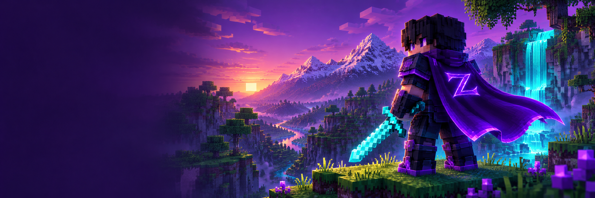

# ZyroxClient downloads



**Your game. Your style.** Free public preview for Minecraft Java Edition.

Public download website and packaged preview releases for ZyroxClient.

**Website:** https://sonixdeveloper.github.io/ZyroxClient/

**Downloads:** https://github.com/SonixDeveloper/ZyroxClient/releases/tag/v0.2.0

## Download now

Files are hosted directly on GitHub Releases and can be downloaded without signing in.

| Platform | Download |
| --- | --- |
| Windows x86_64 | [Download EXE](https://github.com/SonixDeveloper/ZyroxClient/releases/download/v0.2.0/ZyroxClient-0.2.0-windows-x86_64.exe) · [ZIP](https://github.com/SonixDeveloper/ZyroxClient/releases/download/v0.2.0/ZyroxClient-0.2.0-windows-x86_64.zip) |
| Linux x86_64 | [Download AppImage](https://github.com/SonixDeveloper/ZyroxClient/releases/download/v0.2.0/ZyroxClient-0.2.0-x86_64.AppImage) · [Flatpak](https://github.com/SonixDeveloper/ZyroxClient/releases/download/v0.2.0/ZyroxClient-0.2.0-x86_64.flatpak) |
| Android 8.0+ | [Download Companion APK](https://github.com/SonixDeveloper/ZyroxClient/releases/download/v0.2.0/ZyroxClient-0.2.0-android-companion.apk) — **does not run Minecraft Java** |
| Fabric 1.21.4 | [Download mod JAR](https://github.com/SonixDeveloper/ZyroxClient/releases/download/v0.2.0/zyrox-client-fabric-1.21.4-0.2.0.jar) |
| Integrity | [SHA-256 checksums](https://github.com/SonixDeveloper/ZyroxClient/releases/download/v0.2.0/SHA256SUMS) |

The release downloads are independent of the GitHub Pages deployment.

## What is available

- Native Rust desktop launcher: Linux AppImage, Linux Flatpak and Windows x86_64 EXE/ZIP.
- Java Fabric **1.21.4** mod with 13 modules, a custom menu, configuration, profiles and a HUD editor.
- Android **companion** APK for accounts, version metadata, verified client-JAR downloads and profile exports. **It does not run Minecraft Java.**

This is a free public preview. The launcher lists Mojang's official game versions; the native Zyrox mod does not support every listed version. Minecraft game files are fetched from upstream and are not included in the downloads.

## Accounts and verification

Microsoft sign-in requires the developer's own approved public application client ID in Settings. Ely.by uses a separate account system for compatible community servers. Real-account login has not been end-to-end tested with either provider.

- [Installation](guides/INSTALLATION.md)
- [Microsoft and Ely.by account setup](guides/ACCOUNTS.md)
- [Build and test report](guides/VERIFICATION.md)

Release assets include SHA-256 checksums. The Windows executable is not Authenticode-signed. The Android companion is locally release-signed and has not been tested on a device. Linux GUIs were tested; the Windows GUI was tested under Wine.

## Website development

This repository contains the download website source. It has no build dependency or tracker. Preview with:

```sh
python3 -m http.server 8080
```

GitHub Pages publishes the `main` branch root. `.nojekyll` preserves this buildless HTML/CSS/JavaScript site. Download anchors work without JavaScript; `release.json` supplies exact package sizes and URLs when JavaScript is available.

To publish a new preview, upload the real binary assets to a new GitHub Release, verify their checksums, update the versioned links and `release.json`, then push the website changes. Do not commit local game accounts, build caches or signing keys.

## Community

- Discord: https://discord.gg/KwDEc3S7HJ
- YouTube: https://www.youtube.com/@Igorixowy

Not affiliated with Mojang or Microsoft. Minecraft is a trademark of Mojang Synergies AB.

Website/source assets: [MIT](LICENSE), except the included Bitstream Vera font, whose license is in [assets/FONT-LICENSE.txt](assets/FONT-LICENSE.txt).
